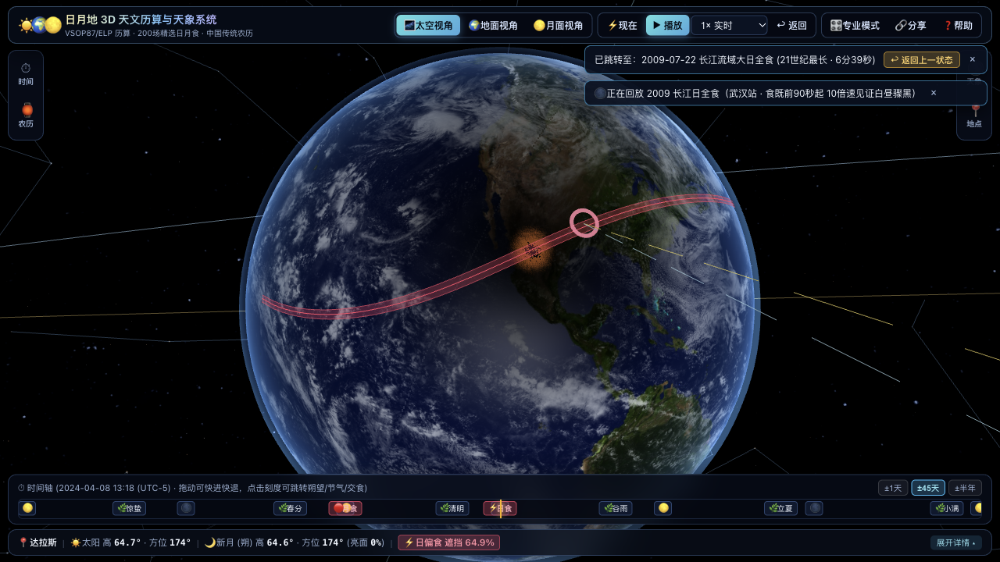
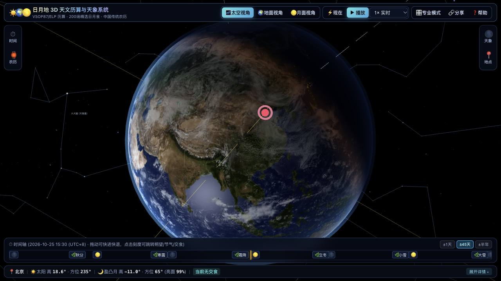
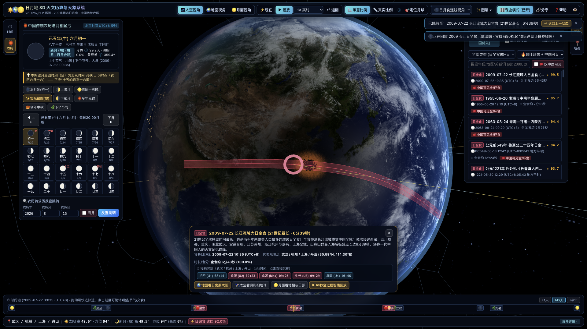
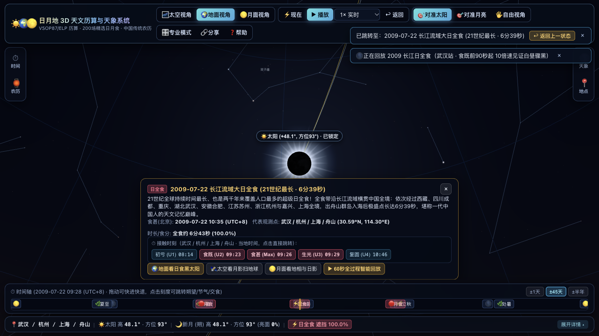
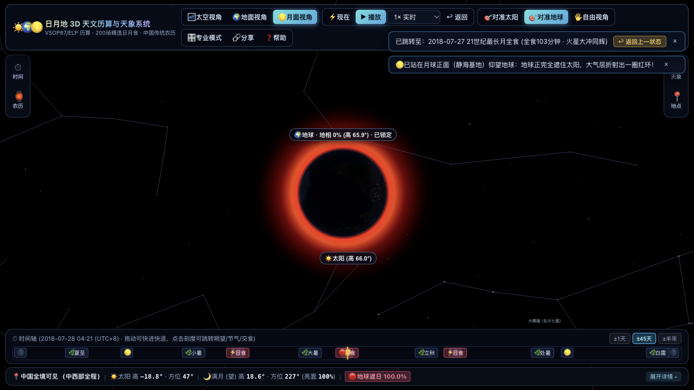
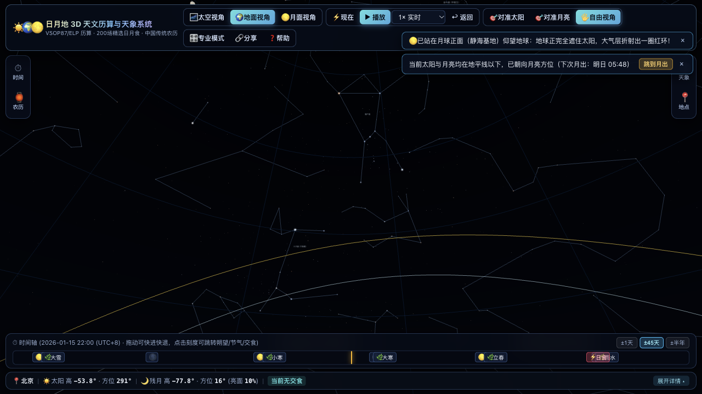
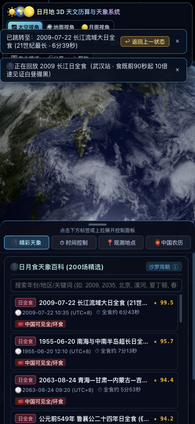

# ☀️🌍🌕 日月地 3D 实时天文、日月食历算与传统农历系统 (`moonsun`)

[](./LICENSE)
[](https://github.com/ChingYung717/moonsun/actions/workflows/deploy.yml)

🔗 **在线演示 (GitHub Pages)**：https://chingyung717.github.io/moonsun/



一个基于 **Three.js (WebGL2 + 自定义 GLSL 着色器)**、**Astronomy Engine (VSOP87 / ELP2000)** 与 **lunar-javascript** 构建的纯前端高精度 3D 日月地天体运行、全球及中国可见日月食模拟与中国传统农历月相交互系统。

📘 **完整图文用户手册**：请参阅 [`docs/使用说明.md`](./docs/使用说明.md)（或在网页右上角点击 **「❓ 帮助」** / 按键盘 `?` 键打开内置可搜索帮助中心）。

---

## 核心特性

1. **高精度天体历算与三种三维观察视角**：
   - **🌌 太空视角 (`SpaceView`)**：J2000 黄道坐标系下的日、地、月实时 3D 轨道运行、真实 4K 地球昼夜晨昏线与城市灯光、月球公转潮汐锁定天平动，以及地球表面的 **日食本影黑斑、半影变暗区与真实法向宽度全食带路径**。
   - **🌍 地球地面视角 (`GroundView`)**：带入地球任意经纬度、海拔与时区，模拟瑞利/米氏大气散射天幕、日全食白昼骤黑与 360° 曙暮光环、珍珠白日冕、**5044 颗真实亮星 (`stars.6.json`)**、**89 个星座连线与中文星官名**，以及实时计算的 **水星、金星、火星、木星、土星** 五大肉眼行星。
   - **🌕 月球表面视角 (`MoonSurfaceView`)**：站在月球正面（静海基地、广寒宫等）或背面仰望地球，观察互补的 **地相盈亏** 与月全食期间 **地球遮挡太阳、地球大气折射形成的铜红色光环**。
2. **200 场精选日月食百科（中国可见高权重优先）**：
   - 严格按配额收录 **90 场日全食 + 35 场日环食 + 60 场月全食 + 15 场古籍记载日食（《诗经》《春秋》等）= 200 场**。
   - 采用 Natural Earth 10m 中国疆域多边形 (`src/astro/geo/chinaBoundary.ts`) 进行全食带球面相交与月食站心高度角可见性判定。
   - 包含 **96 篇人工精修考证专文**（经 `scripts/fact-check-intros.ts` 100% 历算核验零误差）与 **104 篇结构化数据导览**（含途经地区、中国可见省份、最佳城市时长与太阳高度角、精确 NASA 沙罗序列号）。
   - 点选事件弹出 **浮动详情卡片**，支持点击 **初亏 (U1) / 食既 (U2) / 食甚 (Max) / 生光 (U3) / 复圆 (U4)** 直接跳转，以及 **60 秒全过程智能变速回放**（食既至生光自动减速慢放）。
3. **中国传统农历与月相历法**：
   - 实时计算农历年月日（含闰月）、四柱八字干支、生肖、二十四节气交节时刻、朔望月龄与日月黄经差，直观揭示 **“十五的月亮十六圆”**，并提供可翻页的整月微缩月相日历与农历反查公历工具。
4. **清爽渐进式交互体验与新手引导**：
   - 支持 **简洁模式（默认）** 与 **专业模式** 一键切换。
   - 桌面端左右可折叠 **48px 图标栏 + 单抽屉**，移动端底部 **三态抽屉（收起 / 半屏 / 全屏）**。
   - 首次访问提供 **欢迎卡片（3 大一键体验场景）**、**6 步聚光灯交互引导 (`Tour.ts`)**、**可搜索帮助中心 (`HelpCenter.ts`)** 与 **术语内联悬浮解释 (`tooltips.ts`)**。

---

## 📸 截图预览

| 简洁模式（1280×720） | 专业模式与双侧抽屉（1920×1080） |
| :---: | :---: |
|  |  |
| **2009 武汉日全食·地面视角** | **2018 月全食·月面仰望地球红环** |
|  |  |
| **北京冬夜星空与猎户座星座连线** | **移动端底部三态抽屉适配（390×844）** |
|  |  |

---

## 快速启动与常用命令

```bash
# 1. 安装依赖
npm install

# 2. 启动本地开发服务器 (默认 http://localhost:5173)
npm run dev

# 3. 运行天体历算与回归单元测试 (Vitest)
npm test

# 4. 运行 96 篇精选日月食专文程序化事实核查脚本
npx tsx scripts/fact-check-intros.ts

# 5. 重新生成 200 场精选日月食星表 (src/astro/eclipses/catalog.json)
npx tsx scripts/build-catalog.ts

# 6. 构建生产版本 (含 TypeScript 严格类型检查与代码分包)
npm run build
```

---

## 目录结构

```text
moonsun/
├── docs/
│   ├── 使用说明.md              # 完整中文图文使用手册
│   └── images/                  # 说明书配图与实机验证截图
├── public/
│   ├── data/                    # J2000 真实亮星表 (stars.6.json) 与 89 星座连线
│   └── textures/                # 4K / 2K 地球昼夜、云层、法线、月球、太阳与银河贴图
├── scripts/
│   ├── build-catalog.ts         # 200 场精选日月食构建与配额排序脚本
│   ├── fact-check-intros.ts     # 96 篇人工简介历算事实核查脚本
│   └── fetch-textures.sh        # 行星贴图下载脚本
├── src/
│   ├── astro/                   # 天体力学核心 (星历、坐标系、地平转换、五大行星、日月食、农历)
│   ├── render/                  # Three.js 渲染器、GLSL 着色器、真实星场与三大视角
│   ├── state/                   # 全局响应式状态与撤销栈 (AppState.ts)
│   ├── time/                    # 仿真时钟、时区、儒略历与 ΔT 工具
│   └── ui/                      # 顶栏、可折叠侧栏、时间轴、浮动天象卡片、欢迎引导与帮助中心
└── tests/                       # Vitest 历算精度与回归测试套件 (46 项断言)
```

---

## 数据与素材来源 (Credits)

- **天体表面贴图**：来自 NASA Visible Earth (Blue Marble / Black Marble)、NASA Scientific Visualization Studio (CGI Moon Kit, LRO)（公有领域 Public Domain）与 Solar System Scope / ESO（CC BY 4.0），详见 [`public/textures/CREDITS.md`](./public/textures/CREDITS.md)。
- **恒星表与星座连线** (`public/data/stars.6.json`, `constellations.lines.json`)：衍生自 [d3-celestial](https://github.com/ofrohn/d3-celestial)（BSD-3-Clause License, © Olaf Frohn）。
- **中国疆域多边形** (`src/astro/geo/chinaBoundary.ts`)：衍生自 [Natural Earth](https://www.naturalearthdata.com/) 10m 数据（公有领域 Public Domain）。
- **核心开源依赖**：[Three.js](https://threejs.org/) (MIT)、[Astronomy Engine](https://github.com/cosinekitty/astronomy) (MIT)、[lunar-javascript](https://github.com/6tail/lunar-javascript) (MIT)、[Luxon](https://moment.github.io/luxon/) (MIT)、[tz-lookup](https://github.com/darkskyapp/tz-lookup-oss) (CC0-1.0)。

---

## 许可证 (License)

本项目源代码基于 **[MIT License](./LICENSE)** 开源（Copyright © 2026 ChingYung717）。第三方天体贴图与科学数据集遵循其各自原始许可协议，详见 [`public/textures/CREDITS.md`](./public/textures/CREDITS.md)。
