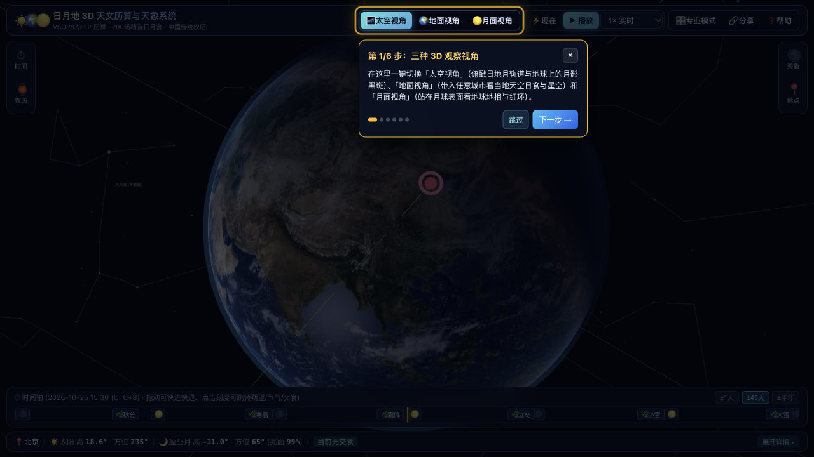
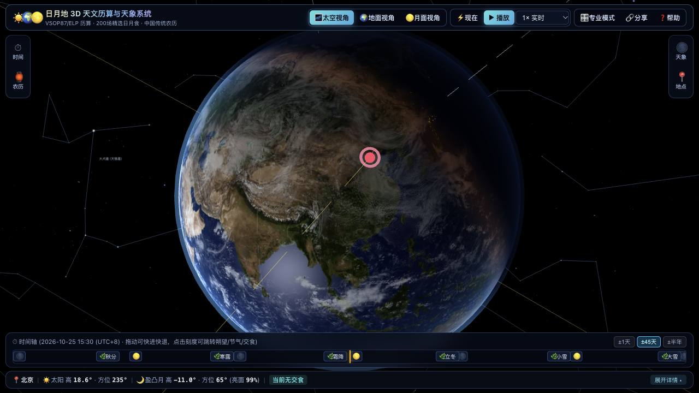
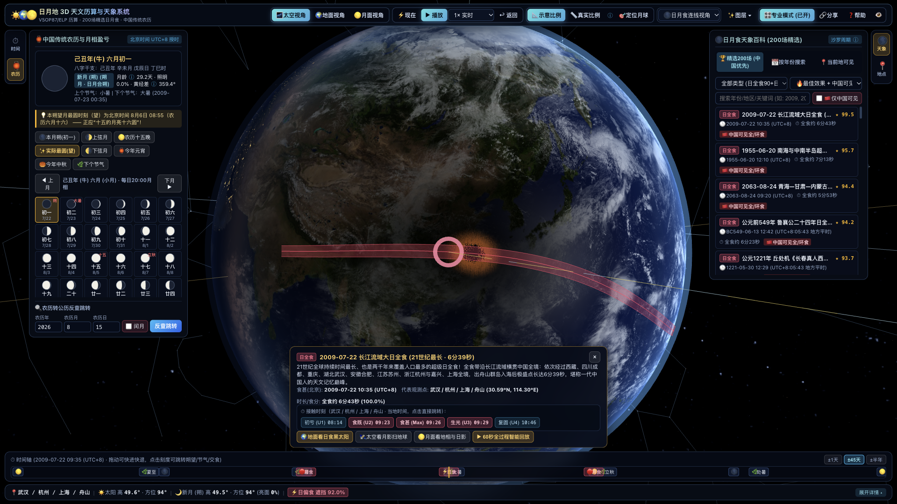
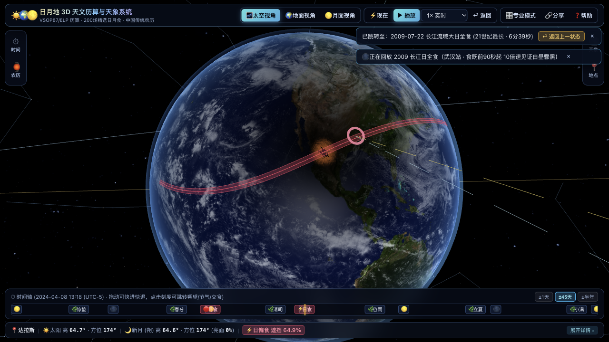
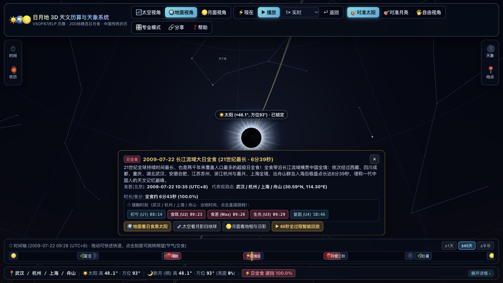
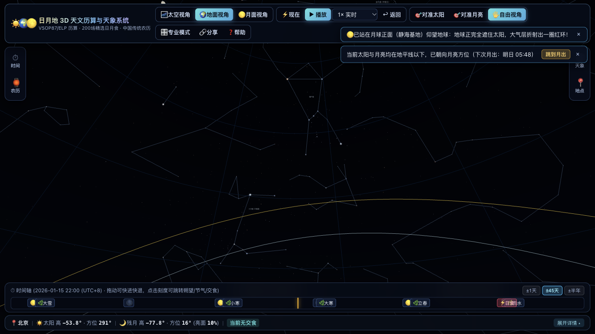
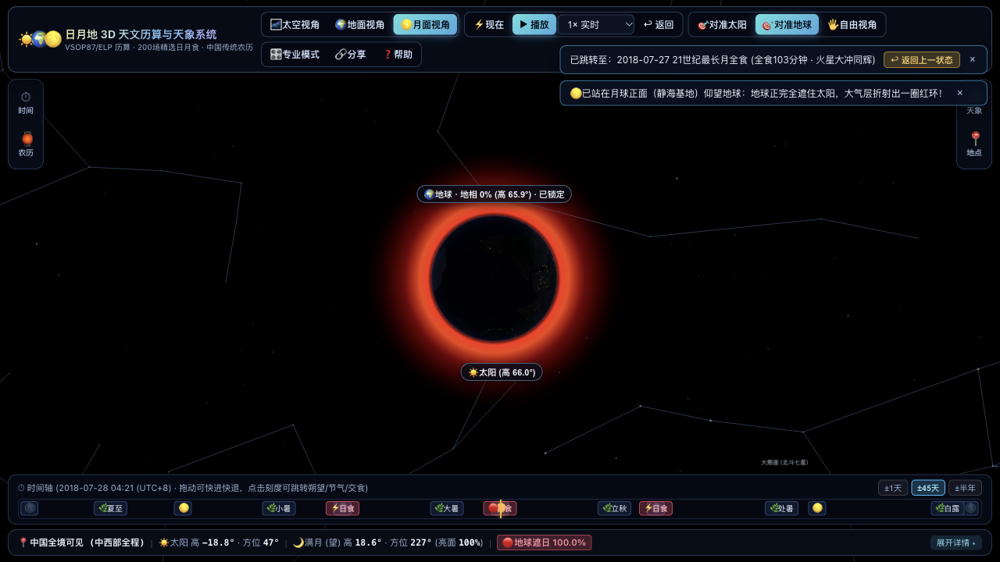
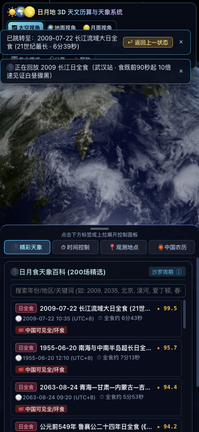
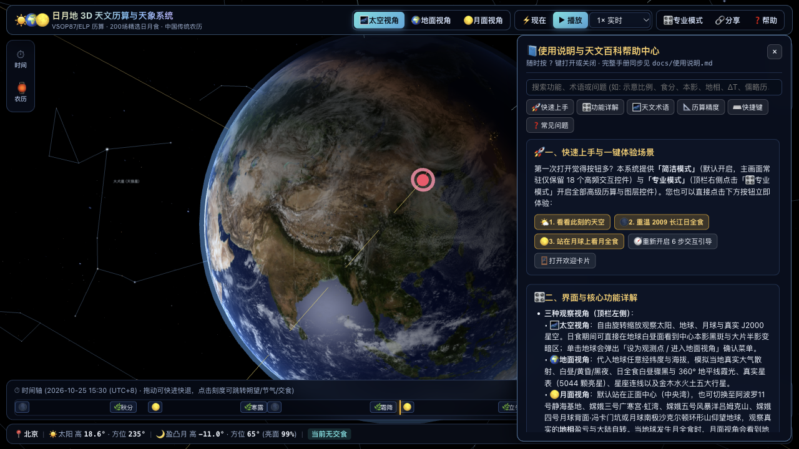

# ☀️🌍🌕 日月地 3D 实时天文、日月食历算与传统农历系统 · 详细使用说明书

欢迎使用 **日月地 3D 实时天文、日月食历算与传统农历系统**。本系统基于高精度天体力学星历（VSOP87 / ELP2000）、4K 行星表面贴图、5044 颗真实亮星表与 89 星座连线，支持在浏览器中实时模拟太阳、地球与月球的 3D 空间运行、全球与中国可见的 **200 场精选日月食**（含《诗经》《春秋》等古籍日食）、任意经纬度与海拔的第一人称地面天空视角、站在月球表面仰望地球的月面视角，以及中国传统农历（干支八字、二十四节气、朔望月相盈亏与“十五的月亮十六圆”）。

---

## 目录

1. [一分钟快速上手与三大一键体验场景](#一分钟快速上手与三大一键体验场景)
2. [简洁模式 vs 专业模式](#简洁模式-vs-专业模式)
3. [三种核心 3D 观察视角详解](#三种核心-3d-观察视角详解)
   - [1. 太空视角（Space View）](#1-太空视角space-view)
   - [2. 地球地面视角（Ground View）](#2-地球地面视角ground-view)
   - [3. 月球表面视角（Moon Surface View）](#3-月球表面视角moon-surface-view)
4. [界面布局与四大侧边抽屉面板](#界面布局与四大侧边抽屉面板)
   - [顶栏（TopBar）与底部时间轴（Timeline）](#顶栏topbar与底部时间轴timeline)
   - [左侧面板 ①：时间与天体运行速率（⏱ 时间）](#左侧面板-时间与天体运行速率-时间)
   - [左侧面板 ②：中国传统农历与月相历法（🏮 农历）](#左侧面板-中国传统农历与月相历法-农历)
   - [右侧面板 ③：地球与月面观测点设置（📍 地点）](#右侧面板-地球与月面观测点设置-地点)
   - [右侧面板 ④：200 场精选日月食天象百科（🌑 天象）](#右侧面板-200-场精选日月食天象百科-天象)
5. [浮动天象详情卡片与 60 秒全过程智能回放](#浮动天象详情卡片与-60-秒全过程智能回放)
6. [天文术语通俗图解百科](#天文术语通俗图解百科)
7. [历算模型精度、ΔT 与儒略历说明](#历算模型精度δt-与儒略历说明)
8. [键盘快捷键与触屏手势速查表](#键盘快捷键与触屏手势速查表)
9. [常见问题解答（FAQ）](#常见问题解答faq)

---

## 一分钟快速上手与三大一键体验场景

首次打开页面时，系统会自动弹出 **欢迎卡片**（您也可以随时点击顶栏右上角的 **「❓ 帮助」→「🪟 打开欢迎卡片」** 再次唤出）：

如果您是第一次接触本系统，无需面对复杂的天文参数，只需点击以下 **3 个一键体验场景** 即可立即观赏：

1. **🌤 1. 看看此刻的天空**
   - 自动同步到您的系统当前真实时间，并切换至当前地球观测点（默认北京，可在「📍 地点」面板随时切换城市或使用浏览器定位）的 **地球地面视角**。
   - 镜头会自动判断当前是白昼还是夜晚，优先对准地平线以上的太阳或月亮；若太阳与月亮均在地平线以下，会提示下次月出/日出时间并提供一键跳转按钮。
2. **🌑 2. 重温 2009 长江大日全食**
   - 一键穿越到 **2009 年 7 月 22 日上午（武汉站）**——21 世纪中国可见持续时间最长的日全食。
   - 自动以 10 倍速从食既（`09:23:56`）前 90 秒开始播放，让您亲眼见证残日收拢、食既瞬间白昼骤然变黑夜、360° 地平线泛起橘红暮光、太阳外围绽放珍珠白日冕，以及日面左下方同框显现的 **水星（`-1.2` 等）** 与南方高空的 **金星（`-4.1` 等）**。
3. **🌕 3. 站在月球上看月全食**
   - 一键穿越到 **2018 年 7 月 28 日凌晨月全食**，并将月面观测点切换至 **阿波罗11号着陆点 (静海基地)** 仰望地球。
   - 当地球上的人们正在观赏“红月亮”时，站在月球上的您会看到 **地球庞大的黑影完全遮住太阳，而地球边缘大气层由于瑞利散射与折射，亮起一圈璀璨的铜红色霞光环**！

> **💡 想要 1 分钟熟悉全部操作？**
> 点击欢迎卡片底部的 **「🧭 带我 1 分钟逛遍界面 (6步引导)」**，系统会以聚光灯高亮方式一步步带您认识顶栏视角切换、底部可拖动时间轴、地点选择、200 场日月食百科以及传统农历面板。

---

## 简洁模式 vs 专业模式

为了让普通天文爱好者与专业观测者都能获得舒适体验，本系统支持双模式一键切换（状态会自动保存在浏览器中）：

- **✨ 简洁模式（默认开启）**：
  - 隐藏低频专业控件（如公元前历史年份、交食分类多维筛选、轨道辅助网格、手动视场角滑条等），主画面常驻仅保留 **18 个高频交互控件**。
  - 在笔记本屏幕（如 `1280×720`）下，左右两侧抽屉默认收起为 **46px 图标窄栏**，中央 3D 宇宙画布无遮挡宽度超过 **1150px**。

- **🎛 专业模式（点击顶栏右上角「🎛 专业模式」开启）**：
  - 解锁全部天文控制项：**示意比例 / 1:1 真实比例切换**、**太空相机预设视角**（聚焦地球、跟随月球、日月食连线视角、黄道北极俯视、聚焦太阳）、**12 项 3D 辅助图层开关**、**公元前 1999 年～公元 3000 年任意年份日月食实时搜索** 以及 **日月视直径放大与视场角调节**。

---

## 三种核心 3D 观察视角详解

通过顶栏左侧的按钮组（或键盘快捷键 `1`、`2`、`3`），可以在三种截然不同的三维参考系之间无缝切换：

### 1. 太空视角（Space View）
- **交互方式**：鼠标左键拖动旋转视角，滚轮缩放距离，右键拖动平移焦点。
- **核心看点**：
  - **日夜晨昏线与城市夜景灯光**：地球昼半球呈现真实 4K 卫星地貌、海洋高光与动态大气云层，夜半球自动亮起人类城市灯光。
  - **日食地表本影与半影**：当日食发生时，月球阴影投射在地球白昼面上，中心是漆黑的 **本影黑斑（全食/环食核心区）**，外围是大片 **半影变暗区（偏食区）**，并带有暖橙色本影边缘过渡。
  - **真实宽度的日食本影带路径**：红色的中心线代表全食/环食中心轨迹，上下两条浅蓝色边界线代表严格按阴影速度法向与椭球面斜截伸长计算出的 **南北全食限界线**（例如 2024 年 4 月 8 日北美日全食在达拉斯附近的带宽精准还原为约 193 公里）。
  - **地球单击选点确认菜单**：在太空视角下单击地球任意位置，会弹出小巧的确认气泡，显示该点经纬度，可选择 **「📍 设为观测点」** 或 **「🌍 进入此地地面视角」**，避免旋转地球时误触改掉当前城市。

### 2. 地球地面视角（Ground View）
- **交互方式**：进入后镜头会自动对准地平线以上的太阳或月亮；您也可以随时点击顶栏的 **「🎯 对准太阳」**、**「🎯 对准月亮」** 或切换至 **「🖐 自由视角」** 拖动环顾 360° 地平圈。
- **核心看点**：
  - **物理大气瑞利/米氏散射天幕**：随太阳高度角实时呈现正午蔚蓝天空、日出日落金红霞光、民用/航海/天文晨昏蒙影以及深邃夜空。
  - **日全食白昼骤黑与日冕**：当观测地发生日全食（食既至生光）时，天空迅速转为深邃靛蓝色，地平线四周亮起 360° 橘红色曙暮光环，黑太阳外围绽放流线型珍珠白日冕。
  - **真实 J2000 亮星表、89 星座连线与五大行星**：夜晚或日全食期间，天幕精确绘制 **5044 颗视星等 ≤ 6.0 等的真实恒星**（按 B-V 色指数还原蓝白巨星与红巨星色彩）、**89 个国际标准星座连线与中文星官名**（如猎户座、大熊座/北斗、金牛座、天蝎座等），以及实时计算的 **水星、金星、火星、木星、土星** 五大肉眼行星。
  - **画内天体标签与画外边缘方向箭头**：当太阳或月亮位于视野之外时，屏幕边缘会自动浮现指示箭头（标明当前高度角与方位，点击箭头即可一键转头对准）。

### 3. 月球表面视角（Moon Surface View）
- **交互方式**：默认站在 **正面中心 (中央湾 `0.0°N, 0.0°E`)**（可在「📍 地点」面板切换至 **阿波罗11号着陆点 (静海基地)**、**嫦娥三号着陆点 (广寒宫·虹湾)**、**嫦娥五号采样点 (风暴洋吕姆克山)**、**嫦娥四号着陆点 (月球背面·冯卡门坑)** 或 **月球南极 (沙克尔顿环形山)**），镜头可锁定 **「🎯 对准地球」** 或 **「🎯 对准太阳」**。
- **核心看点**：
  - **地相盈亏（Earth Phase）**：在月球表面仰望地球，地球视直径约为地球上看月亮的 3.7 倍。地相与月相严格互补——农历初一（地球新月）时月球上看到的是明亮的“满地”；农历十五（地球满月）时看到的是暗面朝向月球的“新地”。
  - **月面看月全食 = 地球遮日红环**：当地球上发生月全食时，从月球表面看去，正是地球遮挡太阳的“月面日全食”，地球黑影周围会亮起一圈由地球全球大气层折射太阳红光形成的 **铜红色光环**！

---

## 界面布局与四大侧边抽屉面板

### 顶栏（TopBar）与底部时间轴（Timeline）
- **顶栏快捷控制**：随时切换三种视角、点击 **「⚡ 现在」** 回到真实时间、点击 **「⏸ 暂停 / ▶ 播放」**、切换倍速，或点击 **「↩ 返回」**（快捷键 `Backspace`）撤销最近一次跳转。
- **底部可拖动时间轴**：
  - 支持 **±1天**、**±45天**、**±半年** 三档时间跨度缩放。
  - 自动在轨道上标出 **🌑 朔（新月）**、**🌕 望（满月）**、**🌿 二十四节气** 与 **⚡ 日食 / 🔴 月食** 刻度。
  - 按住时间轴左右拖动即可连续改变时间；直接点击任意刻度图标即可精准跳至该朔望、节气或交食时刻。
- **底部实时数据栏（InfoHUD）**：
  - 默认以 **单行紧凑模式** 显示当前观测点、太阳高度/方位、月亮高度/方位/月相亮面比例以及当前交食状态。
  - 点击右侧 **「展开详情 ▴」** 可展开完整的四栏实时天文遥测数据（含赤经/赤纬、日地/地月距离、当日日出日落与月出月落时刻、线性食分与本影食分）。

### 左侧面板 ①：时间与天体运行速率（⏱ 时间）
- **多时区实时时钟**：同时显示所选观测点当地时间、北京时间（UTC+8）与世界协调时（UTC），并在历史日期下自动附注儒略历日期。
- **日期快选芯片**：提供 **「今天此刻」**、**「今晚 20:00」**、**「明早日出」**、**「下次日食」**、**「下次月食」** 一键快选。
- **防误触脏状态输入框**：当您手动修改年/月/日/时/分/秒输入框时，输入框会高亮为金色，自动暂停系统时钟覆写；按 `Enter` 键或点击发光的 **「跳转」** 按钮立即生效，按 `Esc` 键放弃修改还原。
- **公元前与古籍历法提示**：当进入公元 1600 年以前或 1582 年格里历改革以前的历史日期时，自动显示 **儒略历日期换算** 与 **ΔT 地球自转长期修正说明**。

### 左侧面板 ②：中国传统农历与月相历法（🏮 农历）
- **传统农历核心卡片**：实时绘制受光角准确的 2D 月相盘，显示农历年月日（含闰月标识）、年/月/日/时四柱干支八字、生肖、当前节气与下一节气时刻。
- **“十五的月亮十六圆”科学揭示栏**：实时计算本朔望月内真正的力学满月（日月黄经差 `180°`）落在该农历月的哪一天几时几分，直观解释为什么满月常出现在农历十六甚至十七。
- **整月月相日历网格**：支持点击 **「◀ 上月」**、**「下月 ▶」** 翻阅 1901–2099 年间任意农历月份，每一天绘有当日北京时间 20:00 的微缩月相图标，并标注传统节日、二十四节气、朔（初一）与农历十五（精确力学望/弦时刻见上方科学揭示栏与快捷按钮），点击任意日期格即可跳至当天北京时间 20:00。
- **农历反查公历（专业模式）**：输入任意公历年、农历月（支持勾选闰月）与农历日，一键反查对应的公历日期并跳转。

### 右侧面板 ③：地球与月面观测点设置（📍 地点）
- **预设城市与智能模糊搜索**：内置中国主要省会及全球代表性天文观测点，搜索框支持输入中文城市名（如 `拉萨`、`漠河`、`台北`）或直接粘贴经纬度坐标（如 `31.23, 121.47`）。
- **月面观测站切换**：内置 **正面中心 (中央湾)**、**阿波罗11号着陆点 (静海基地)**、**嫦娥三号着陆点 (广寒宫·虹湾)**、**嫦娥五号采样点 (风暴洋吕姆克山)**、**嫦娥四号着陆点 (月球背面·冯卡门坑)** 与 **月球南极 (沙克尔顿环形山)** 六大月面站点，并支持手动输入任意月面经纬度。

### 右侧面板 ④：200 场精选日月食天象百科（🌑 天象）
- **三大标签页**：
  1. **精选 200 场（中国优先）**：严格收录 **90 场近现代日全食 + 35 场近现代日环食 + 60 场月全食 + 15 场古籍记载日食（含 13 场古籍日全食与 2 场古籍日环食；按类型筛选时日全食共 103 场、日环食共 37 场）= 200 场**，每场均配有详实的中文背景与观测导览（其中 96 场为人工精修考证专文，104 场为包含途径国家、中国可见省份、最佳城市时长与太阳高度角及 NASA 沙罗序列号的数据导览）。
  2. **按年份搜索**：输入 `-1999` 至 `3000` 之间的任意年份，实时计算该年全球所有日食与月食。
  3. **当前地点可见**：自动从当前模拟时间起向后检索当前地球观测点接下来可见的 **6 场日食**（日偏食、日环食或日全食），并精确列出当地初亏、食甚、复圆时刻与最大遮挡面积比。
- **移动端底部三态抽屉适配**：在手机屏幕（`< 760px`）下，四个侧边面板自动合并为底部可上拉/下拉的三态抽屉（收起 / 半屏 / 全屏），确保小屏也能流畅浏览 3D 宇宙与天象清单。

---

## 浮动天象详情卡片与 60 秒全过程智能回放

当您在「🌑 天象」列表中点击任意一场日月食时，右侧列表不会被详情挤没，而是在画面下方中央浮出一张 **可随时关闭的浮动天象详情卡片**：

1. **关键接触时刻一键直达**：
   - 自动计算该天象在代表观测点（或全球统一时刻）的 **初亏（U1）**、**食既（U2）**、**食甚（Max）**、**生光（U3）**、**复圆（U4）** 当地时间按钮，点击任一按钮即可瞬间跳转到该接触阶段。
2. **三大视角快捷切换**：
   - **「🌍 地面看日食黑太阳 / 红月亮」**、**「🛰 太空看月影扫地球 / 月球入地影」**、**「🌕 月面看地球遮日红环 / 地相与日影」**。
3. **▶ 60 秒全过程智能变速回放**：
   - 点击后自动跳至初亏（U1）并开启智能变速回放：在漫长的偏食阶段以较高倍速快进，而在 **食既（U2）至生光（U3）的全食/环食核心阶段自动减速慢放**，让您既不用苦等两小时偏食，又不会错过最震撼的几分钟全食奇观！回放过程中还可随时拖动进度条。

---

## 天文术语通俗图解百科

界面中带有 **ⓘ** 图标的专业术语均可直接点击查看悬浮解释，您也可以按 `?` 键打开 **内置帮助中心** 搜索查阅：

| 术语名称 | 通俗解释 |
| :--- | :--- |
| **示意比例 vs 真实比例** | 真实宇宙中地月距离约为地球直径的 30 倍（60 个地球半径），日地距离更达 1.496 亿公里。若按 1:1 真实比例远景同屏显示，地球和月球只有几个像素大。因此默认 **「示意比例」** 将天体半径适度放大以便看清地貌，但 **日地月方向矢量、月相照明角及地表日食本影位置 100% 采用真实物理坐标计算**；切换至 **「真实比例」** 则展示 1:1 真实尺度并附带位置标签。 |
| **本影（Umbra）与半影（Penumbra）** | 天体背后太阳光被完全遮挡的锥形核心区叫 **本影**（位于其中的观测者看到全食）；太阳光仅被部分遮挡的外围区域叫 **半影**（位于其中的观测者看到偏食）。 |
| **线性食分 vs 遮挡面积比** | **线性食分** 是太阳视直径被月球遮挡的线段比例；**遮挡面积比** 是太阳圆面被遮盖的面积百分比。日全食时线性食分 ≥ 1.0，遮挡面积比为 100%。 |
| **为什么月全食是红色的（红月亮）？** | 月全食时月球进入地球本影，太阳直射光被地球挡住；但太阳光穿过地球边缘大气层时，短波蓝紫光被瑞利散射滤除，长波红橙光被大气折射弯向本影内部照亮月面，呈现古铜红色。 |
| **地相（Earth Phase）** | 站在月球表面看到的地球亮面盈亏。地相与地球上看到的月相严格互补（亮面比例之和为 100%）。 |
| **沙罗周期（Saros）** | 每隔 223 个朔望月（约 18 年 11 天 8 小时），日、地、月与月球轨道交点的几何位置几乎完全重演。例如 1955、1991、2009、2027、2045 年的著名超长日全食均属于 **第 136 沙罗序列**。 |

---

## 历算模型精度、ΔT 与儒略历说明

1. **天体历算内核**：采用基于 VSOP87 与 ELP2000 理论的 `astronomy-engine`，地平坐标包含岁差、章动、周年光行差、站心视差与大气折射修正。
2. **日全食/环食持续时长**：由站心交食第二接触（U2 食既）与第三接触（U3 生光）精确时刻直接相减得出，与 NASA 五千年日月食星表误差在 **±5～10 秒** 以内。
3. **中国可见判定边界**：采用 Natural Earth 10m 精度中国疆域多边形（含台湾省、海南岛、藏南、阿克赛钦及南海诸岛）进行球面几何相交与网格可见度判定（仅用于后台天文可见性计算，不在球面绘制粗略国界线）。
4. **古籍日食与 ΔT 说明**：公元前《诗经》《春秋》《汉书》日食距今两千余年，地球自转长期减速累积的钟差（ΔT）达数小时。不同 ΔT 经验公式会使全食带在东西方向偏移上百公里；当本系统现代外推模型在古都算得的食分与史书“既”记载存在差异时，简介中均如实附有 **【模型说明】**。

---

## 键盘快捷键与触屏手势速查表

| 快捷键 / 手势 | 功能说明 |
| :--- | :--- |
| `Space (空格)` | 播放 / 暂停时间流逝 |
| `1` / `2` / `3` | 切换「🌌 太空视角」/「🌍 地球地面视角」/「🌕 月面视角」 |
| `N` | 立即回到当前系统真实时间（开启实时同步） |
| `←` / `→` | 时间快退 / 快进 1 分钟（按住 `Shift` 为 ±1 天） |
| `Backspace` | 撤销最近一次天象或观测点跳转，返回上一状态 |
| `H` | 隐藏 / 显示全部 UI 面板（全屏纯净观赏 3D 天象） |
| `?` | 打开 / 关闭内置可搜索帮助中心 |
| `Enter` / `Esc` | 在时间输入框中确认跳转 / 放弃修改还原 |
| **双指捏合（触屏）** | 在地面视角或月面视角下双指缩放视场角（FOV 2°～100°） |

---

## 常见问题解答（FAQ）

- **Q1：为什么切换到「地面视角」后有时候看不到月亮或太阳？**
  - **答**：因为当前时刻该天体可能位于当地 **地平线以下**（高度角 `< 0°`）。此时您可以看画面边缘的方向指示箭头，或点击进入地面视角时右上角弹出的 **「跳到月出 / 跳到日出」** 按钮，也可以直接左右拖动底部时间轴让它升起。
- **Q2：如何把当前看到的壮观日全食画面分享给朋友？**
  - **答**：直接点击顶栏右上角的 **「🔗 分享」** 按钮，系统会将包含当前时间、观测点经纬度、视角模式、比例模式及所选日月食 ID 的完整链接复制到剪贴板，打开链接即可 100% 复现同一画面。
